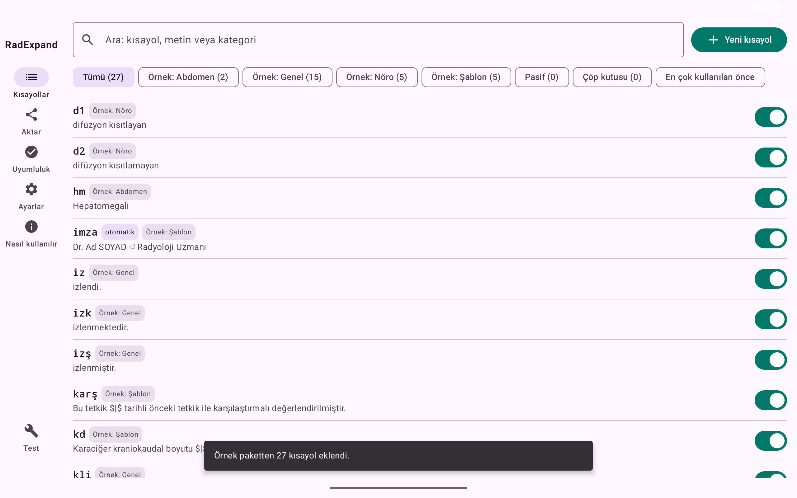
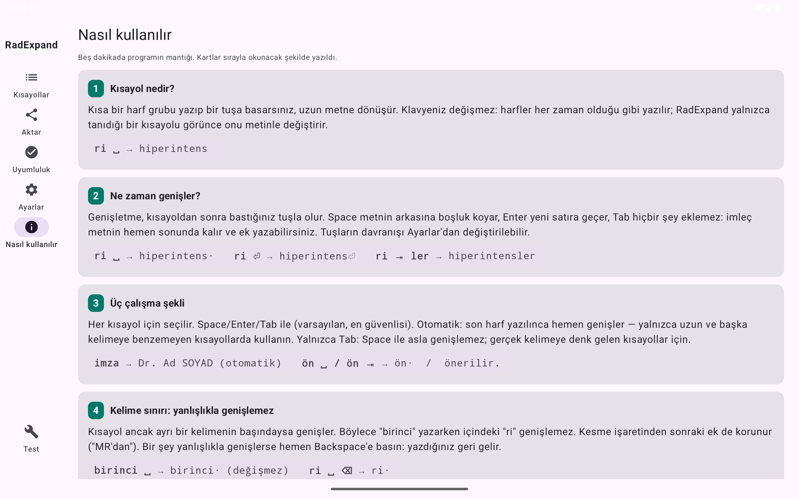

# RadExpand

**[Türkçe](#türkçe) · [English](#english)**

Fiziksel klavye için çevrimdışı metin genişletici: **Android** ve **Windows**.
*Offline text expander for physical keyboards: **Android** and **Windows**.*

[](https://github.com/Oraddi/radexpand/releases/latest)
[](LICENSE)

<p>


</p>

---

## Türkçe

### Ne yapar?
Sık yazdığınız kelime ve cümleleri kısa harf gruplarıyla yazarsınız. Bir tuşa basınca kısayol tam metne dönüşür.
Rapor, şablon ve yazışma gibi tekrar eden metinler için yapıldı. Her programda, her türlü metinde çalışır.

Örnek: kısayol `rp` → metin `rapor`

| Yazdığınız | Sonuç |
|---|---|
| `rp` + **Space** | `rapor␣` |
| `rp` + **Enter** | `rapor` + yeni satır |
| `rp` + **Tab** + `lar` | `raporlar`: Tab hiçbir şey eklemez, imleç metnin sonunda kalır ve ek yazabilirsiniz |
| `turp` + Space | `turp␣`: kısayol bir kelimenin parçasıysa **genişlemez** |
| `Rp` + Space | `Rapor␣` (Ayarlar'dan `rapor␣` olarak bırakmayı da seçebilirsiniz) |
| genişlemeden hemen sonra **Shift + Backspace** | yazdığınız kısayol geri gelir (`rapor` → `rp`); **Backspace** tek başına her zaman normal siler. Geri alma tuşu Ayarlar'dan değiştirilebilir |

- **Tamamen çevrimdışı.** Android uygulamasının internet izni yoktur; yazdıklarınız cihazdan çıkamaz.
- **Kısayol arama paneli (Alt + Space):** kayıtlı kısayollar listelenir; yazarak arayın, Enter ile yazdırın (Espanso'daki gibi).
- **Espanso** dosyalarını (`.yml`) önizlemeyle içe aktarır ve Espanso biçiminde dışa aktarır.
- **Cihazlar arası taşıma:** Drive masaüstü programı varsa ortak bir dosya üzerinden otomatik; yoksa "Drive'a gönder / Drive'dan al" ile iki tıkla elle. Son değişiklik kazanır, silmeler de taşınır.
- **Şablonlar:** `$|$` imlecin duracağı yeri gösterir. Birden fazla `$|$` varsa Tab ile sonrakine geçilir. `{tarih}` ve `{saat}` değişkenleri de kullanılabilir.
  Örnek: `Toplantı $|$ tarihinde, $|$ salonunda yapılacaktır.`
- **Her şey Ayarlar'dan değiştirilebilir:**
  - Space / Enter / Tab'ın görevi ve isteğe bağlı özel genişletme tuşu (ör. F2);
  - kelime kuralları ve büyük harf davranışı;
  - tema, renk, yazı boyutu;
  - yedekler ve uygulama bazında kapatma.
- Uygulamanın içinde kısa bir **"Nasıl kullanılır"** rehberi ve isteğe bağlı bir **örnek kısayol paketi** vardır.
- Arayüz Türkçe ve İngilizcedir; dil ilk açılışta sorulur.

### İndirme
[**Son sürüm sayfası →**](https://github.com/Oraddi/radexpand/releases/latest)

| Dosya | Ne için |
|---|---|
| `RadExpand-x.y.z.apk` | Android 8 ve üstü (fiziksel klavyeyle) |
| `RadExpand-x.y.z.msi` | Windows 10/11 kurulum dosyası (yönetici izni gerekmez) |
| `RadExpand-Windows-x.y.z.zip` | Windows taşınabilir sürüm (kurulumsuz) |

### Android kurulumu
1. APK'yı cihazda açın → **Yükle**. "Bilinmeyen uygulama" izni sorulursa bu kaynağa izin verin.
2. RadExpand'i açın ve dili seçin. Ardından kurulum ekranındaki iki adımı yapın:
   1. klavye ayarlarında RadExpand'i açın;
   2. klavye olarak RadExpand'i seçin.

   Android her klavye için "yazdıklarınızı toplayabilir" uyarısı gösterir; RadExpand'in internet izni yoktur.
3. Türkçe karakterler yanlış çıkarsa: **Ayarlar → Fiziksel klavye düzeni → Türkçe Q**.
4. Fiziksel klavyeyi çıkarınca RadExpand kendiliğinden ekran klavyesine (Samsung Klavye ya da Gboard) geçer. Klavyeyi geri takınca Android otomatik dönmez: alt çubuktaki klavye simgesine dokunup RadExpand'i seçin.

**Otomatik güncelleme (isteğe bağlı):** Uygulamanın kendisi internete çıkmaz. Yeni sürümleri otomatik almak için [Obtainium](https://obtainium.imranr.dev/) uygulamasına bu sayfanın adresini (`https://github.com/Oraddi/radexpand`) ekleyin.
Güncellemeler eski sürümün üzerine kurulur ve kısayollarınız kalır.

### Windows kurulumu
1. `.msi` dosyasını çalıştırın. SmartScreen "tanınmayan uygulama" derse **Ek bilgi → Yine de çalıştır** seçin (uygulama ücretli bir kod imzası taşımaz).
2. RadExpand sistem tepsisinde çalışır. Pencereyi kapatınca arka planda devam eder; sağ tık menüsünde Aç / Duraklat / Çıkış vardır.
3. **Başka bir metin genişletici (ör. Espanso) kullanıyorsanız kapatın.** İkisi birlikte çalışırsa kısayollar iki kez genişler; RadExpand bunu fark edip uyarır.
4. **Güncelleme:** Açılışta ve günde bir kez GitHub'a tek bir küçük istek gönderilir; yazdığınız hiçbir şey gönderilmez.
   Yeni sürüm varsa **Ayarlar → Güncelleme → İndir ve kur** çıkar. Sormadan kurmaz ve kontrol ayarlardan kapatılabilir.

### Bilgisayarlar arasında taşıma (Google Drive, elle)
Birden çok bilgisayar kullanıyorsanız ve Drive masaüstü programı kurulamıyorsa:
1. Kısayol değiştirdiğiniz bilgisayarda **Aktar → Drive'a gönder**: dosya İndirilenler'e kaydedilir, seçili gösterilir ve tarayıcıda Drive açılır. Dosyayı Drive'daki kendi `RadExpand` klasörünüze sürükleyin (aynı ad varsa "Mevcut dosyayı değiştir").
2. Başka bilgisayarda dosyayı Drive'dan indirin ve **Aktar → Drive'dan al** deyin.

Kısayollar birleştirilir: aynı kısayolda daha yeni olan kalır, silmeler de taşınır, hiçbir şey çoğalmaz. Gönderilmemiş değişiklik varsa RadExpand üstte uyarır ve kapanırken sorar. RadExpand'in kendisi internete bağlanmaz.

### Espanso'dan geçiş
**Aktar → Dosya seç** → Espanso `.yml` dosyanız. Windows'ta `%APPDATA%\espanso\match` klasörü kendiliğinden açılır.
Önizlemede kaç kısayolun geleceğini, uyarıları ve çakışmaları görürsünüz. Aynı dosyayı tekrar aktarmak kayıtları çoğaltmaz; orijinal dosya da değişmez.

### Sınırlamalar
- Yalnızca **fiziksel klavye** ile çalışır; ekran klavyesiyle yazarken genişletme yapılmaz.
- Windows'ta **yönetici olarak çalışan** programlarda RadExpand'in de yönetici olarak çalıştırılması gerekir.
- Parola alanları:
  - Windows bunları genel olarak ayırt edemez; parola yöneticinizi **Ayarlar → Uygulama bazında kapatma**'dan kapatın.
  - Android'de parola alanlarında genişletme varsayılan olarak kapalıdır.
- **Test durumu:** Android emülatöründe (Chrome dahil) ve Windows 11'de otomatik testlerle denendi. Farklı cihaz ve uygulamalarda kullanım deneyimi henüz sınırlıdır.
  Sorun görürseniz [bildirin](https://github.com/Oraddi/radexpand/issues).

> **Önemli:** RadExpand bir **tıbbi cihaz değildir** ve hiçbir konuda karar vermez; yalnızca yazmayı hızlandırır. Oluşan metni kontrol etmek kullanıcının sorumluluğundadır.

---

## English

### What it does
Type short abbreviations for words and sentences you use often. Press a key and the abbreviation turns into the full text.
Made for repetitive text such as reports, templates and correspondence. Works in any program, with any kind of text.

Example: shortcut `rpt` → text `report`

| You type | Result |
|---|---|
| `rpt` + **Space** | `report␣` |
| `rpt` + **Enter** | `report` + new line |
| `rpt` + **Tab** + `s` | `reports`: Tab adds nothing; the cursor stays right after the text so you can add a suffix |
| `excerpt` + Space | `excerpt␣`: a shortcut that is part of a word does **not** expand |
| `Rpt` + Space | `Report␣` (or keep it as `report␣`, set in Settings) |
| **Shift + Backspace** right after an expansion | your abbreviation comes back (`report` → `rpt`); **Backspace** alone always deletes normally. The undo key can be changed in Settings |

- **Fully offline.** The Android app has no internet permission; what you type cannot leave the device.
- **Shortcut search panel (Alt + Space):** lists your saved shortcuts; type to search, Enter to insert (like Espanso).
- Imports **Espanso** files (`.yml`) with a preview and exports to Espanso format.
- **Moving between devices:** automatic through a shared file if the Drive desktop program is installed; otherwise by hand in two clicks with "Send to Drive / Get from Drive". The latest change wins; deletions are synced too.
- **Templates:** `$|$` marks where the cursor stops. With several `$|$` marks, Tab jumps to the next one. You can also use `{date}` and `{time}` variables.
  Example: `The meeting will be held on $|$ in room $|$.`
- **Everything is configurable in Settings:**
  - what Space / Enter / Tab do, plus an optional custom expand key (e.g. F2);
  - word rules and capitalisation;
  - theme, colour and text size;
  - backups and per-app disable.
- Includes a short in-app **"How to use"** guide and an optional **sample shortcut pack**.
- The interface is in Turkish and English; you choose the language at first launch.

### Download
[**Latest release →**](https://github.com/Oraddi/radexpand/releases/latest)

| File | For |
|---|---|
| `RadExpand-x.y.z.apk` | Android 8 or later, with a physical keyboard |
| `RadExpand-x.y.z.msi` | Windows 10/11 installer (no admin rights needed) |
| `RadExpand-Windows-x.y.z.zip` | Windows portable (no install) |

### Android setup
1. Open the APK on the device and tap **Install**. Allow installs from this source if asked.
2. Open RadExpand and choose a language. Then follow the two setup steps:
   1. enable RadExpand in keyboard settings;
   2. select RadExpand as the keyboard.

   Android shows a "may collect what you type" warning for every keyboard; RadExpand has no internet permission.
3. When you disconnect the physical keyboard, RadExpand switches to the on-screen keyboard (Samsung Keyboard or Gboard) by itself. Android does not switch back automatically when you reconnect: tap the keyboard icon in the navigation bar and choose RadExpand.

**Automatic updates (optional):** the app itself never goes online. To get new versions automatically, add this repository (`https://github.com/Oraddi/radexpand`) to [Obtainium](https://obtainium.imranr.dev/).
Updates install over the old version and your shortcuts are kept.

### Windows setup
1. Run the `.msi`. If SmartScreen says "unrecognised app", choose **More info → Run anyway** (the app has no paid code-signing certificate).
2. RadExpand lives in the system tray. Closing the window keeps it running; right-click the tray icon for Open / Pause / Exit.
3. **If you use another text expander (e.g. Espanso), close it.** Running both expands shortcuts twice; RadExpand detects this and warns you.
4. **Updates:** one small request goes to GitHub at startup and once a day; nothing you type is ever sent.
   When a new version exists, **Settings → Updates → Download and install** appears. It never installs without asking, and the check can be turned off in Settings.

### Moving between computers (Google Drive, by hand)
If you use several computers and cannot install the Drive desktop program:
1. On the computer where you changed shortcuts, press **Import → Send to Drive**: the file is saved to Downloads, shown selected, and Drive opens in the browser. Drag the file into your own `RadExpand` folder in Drive (if the name exists, choose "Replace existing file").
2. On another computer, download the file from Drive and press **Import → Get from Drive**.

Shortcuts are merged: for the same shortcut the newer one wins, deletions are carried over, nothing is duplicated. If there are unsent changes, RadExpand shows a warning and asks when you exit. RadExpand itself does not connect to the internet.

### Moving from Espanso
**Import → Choose file** → your Espanso `.yml` file. On Windows the `%APPDATA%\espanso\match` folder opens automatically.
The preview shows how many shortcuts will be added, plus any warnings and conflicts. Importing the same file again does not duplicate anything, and the original file is never changed.

### Limitations
- Works with a **physical keyboard** only; nothing is expanded while typing on the on-screen keyboard.
- On Windows, programs running **as administrator** require RadExpand to run as administrator too.
- Password fields:
  - Windows cannot generally detect them, so turn RadExpand off for your password manager in **Settings → Per-app**.
  - On Android, expansion in password fields is off by default.
- **Testing status:** tested with automated tests on an Android emulator (including Chrome) and on Windows 11. Real-world use across different devices and apps is still limited.
  Please [report problems](https://github.com/Oraddi/radexpand/issues).

> **Important:** RadExpand is **not a medical device** and makes no decisions of any kind; it only speeds up typing. Checking the resulting text is the user's responsibility.

---

## Geliştirme / Development

```
core/       engine, data model, Espanso import/export, sync merge (pure Kotlin, unit-tested)
ui-shared/  Compose screens shared by Android and Windows
app/        Android keyboard service (InputMethodService) + app
desktop/    Windows: low-level keyboard hook (JNA), SendInput, tray, Compose UI
tools/      emulator / Windows end-to-end test scripts (PowerShell)
```

Requirements: JDK 21 and the Android SDK (`ANDROID_HOME`).

```bash
./gradlew :core:test                    # unit tests
./gradlew :app:assembleRelease          # APK (unsigned unless a keystore is configured)
./gradlew :desktop:packageMsi           # Windows installer
```

Pushing a `v*` tag makes GitHub Actions build the release (see `.github/workflows/release.yml`). The APK signing key is stored only in repository secrets.

## Lisans / License
[MIT](LICENSE) © Umitcan Yildiz. Third-party components: [THIRD_PARTY_NOTICES.md](THIRD_PARTY_NOTICES.md).
